# One Piece Atlas — atlas interactivo de la One Piece Wiki

Atlas navegable de las fichas de la [One Piece Wiki en español](https://onepiece.fandom.com/es/) (Fandom, licencia CC BY-SA) con sus **artículos completos**, unidas por sus relaciones: personajes, tripulaciones, frutas del Diablo, barcos, islas, sagas, capítulos y episodios. Modelo de [ladonacion.es](https://ladonacion.es/), pero de One Piece.

**Web: <https://carlosdarko.github.io/one-piece-wiki/>** · ⚠️ contiene spoilers de todo el manga y el anime.

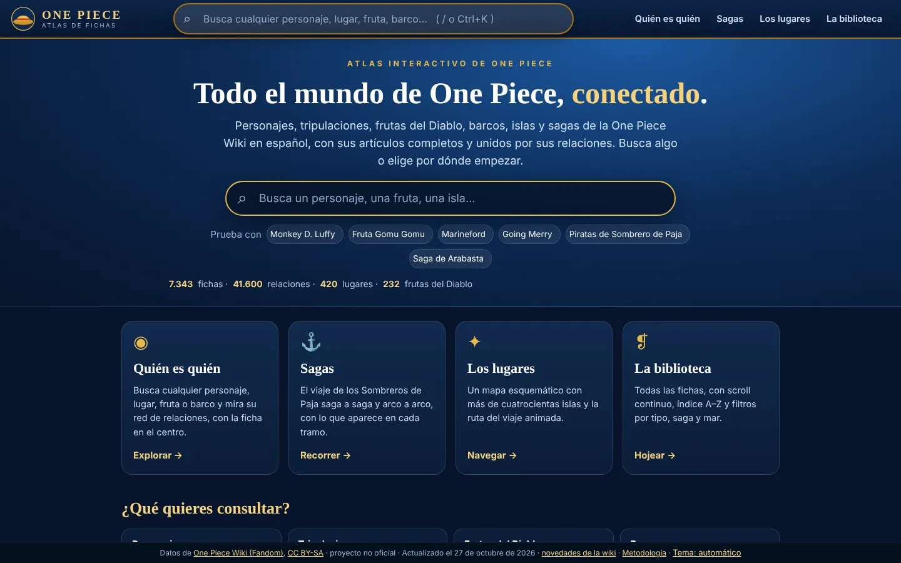

> Las capturas de este README se regeneran solas en cada actualización semanal (ver [Capturas](#capturas)). Si Fandom bloquea sus imágenes al navegador automatizado, las fichas salen con iniciales de colores en lugar de fotos; en la web real se ven las fotos.

## Índice

[Qué puedes hacer](#qué-puedes-hacer) · [Cómo se construye](#cómo-se-construye-el-atlas) · [Arquitectura](#arquitectura) · [Ejecutarlo y probarlo en local](#ejecutarlo-y-probarlo-en-local) · [Publicación y actualización automática](#publicación-y-actualización-automática) · [Capturas](#capturas) · [Limitaciones](#limitaciones-conocidas) · [Créditos y licencia](#créditos-y-licencia)

## Qué puedes hacer

### Buscar cualquier ficha

El buscador de la cabecera (atajo `/` o `Ctrl+K`) busca en todas las fichas, agrupa los resultados por tipo (personajes, frutas del Diablo, obras y medios, episodios…) y se maneja con teclado. Busca también por los alias y redirecciones de la wiki.

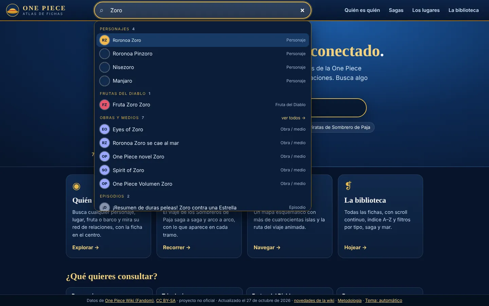

### Quién es quién: el grafo de relaciones

Escribe o elige cualquier ficha y se dibuja su **red de relaciones** alrededor: cada nodo tiene color e icono por tipo (personaje, organización, fruta del Diablo, barco, lugar…) y las aristas se agrupan en **categorías y subcategorías** con una etiqueta (Familia → Padre, Hermanos adoptivos, Abuelo…; Tripulación; Aliados; Enfrentamientos; Mascotas y compañeros animales; Fruta del Diablo; Reside en / Originario de; Capitán de / Miembro de; Propietario de…). Pulsar un nodo lo centra y abre su ficha; los nodos «+N ver más» despliegan el resto. Hay vista **Grafo** y vista **Lista** (accesible), zoom, pantalla completa y un desplegable **Relaciones** para mostrar u ocultar cada categoría.

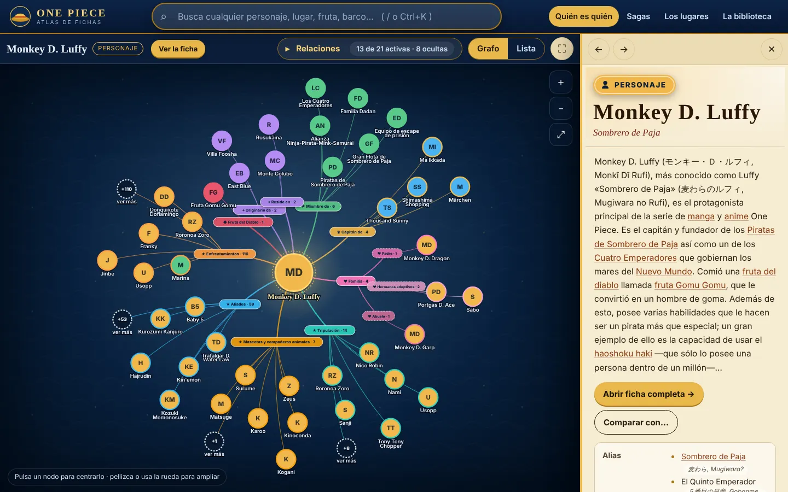

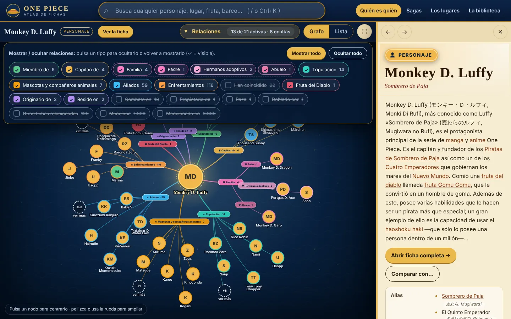

Funciona con cualquier tipo de ficha, no solo con personajes; por ejemplo, una fruta del Diablo muestra sus relaciones con usuarios, evoluciones y fichas asociadas:

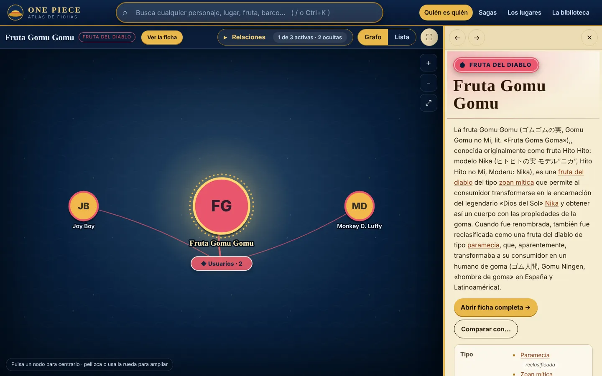

### Ficha completa

El artículo **íntegro** de la wiki, limpiado y maquetado: índice, secciones plegables, infobox con alias, ocupación, recompensa…, relaciones, migas de pan, enlaces internos que navegan por el atlas y **atribución** con enlace a la página original y a su historial de autores.

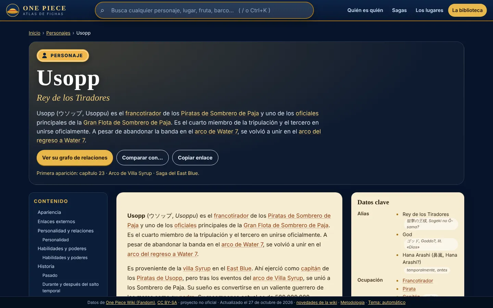

### Sagas

El viaje **saga a saga y arco a arco**, con portadas, lo que aparece en cada tramo (personajes, lugares, frutas…) y desplegables animados.

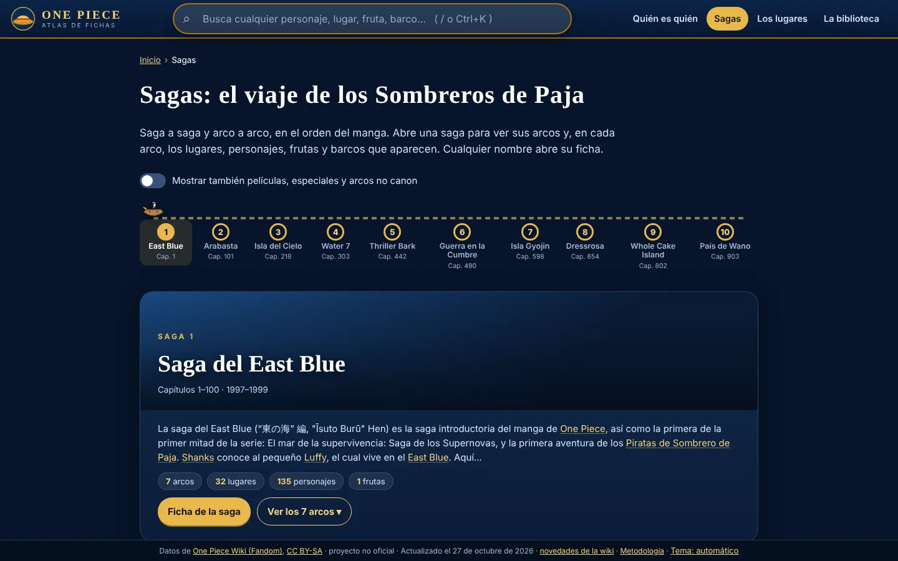

### Los lugares: mapa con ruta animada

Carta náutica esquemática del mundo (no es un mapa geográfico: las islas se colocan por mar y por orden de aparición) con filtros por mar, saga y tipo, buscador, leyenda, ficha-resumen de cada isla y modo lista. El botón **Ruta del viaje** anima el recorrido isla a isla, con controles de pausa, salto, reinicio y velocidad.

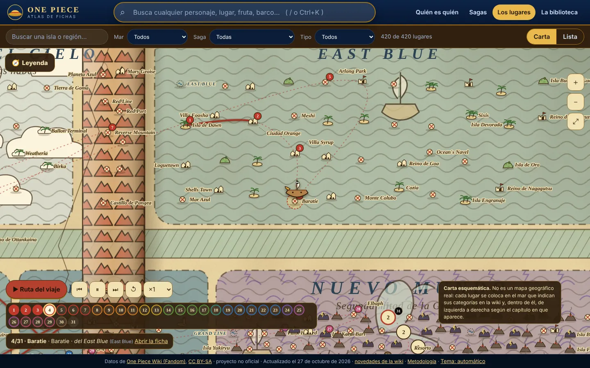

### La biblioteca y el comparador

Todas las fichas con scroll continuo virtualizado, índice A–Z, filtros por tipo, saga y mar, orden, contador y URL compartible; incluye el ranking de recompensas. El **comparador** pone dos fichas lado a lado: datos, relación directa, fichas en común y exclusivas.

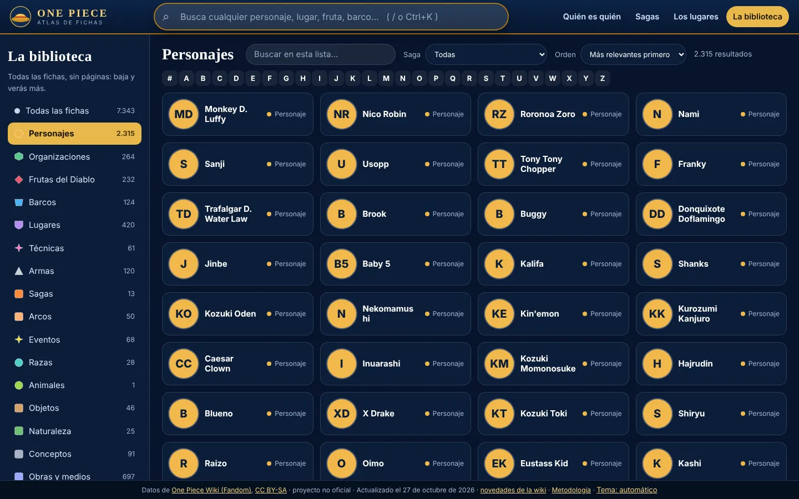

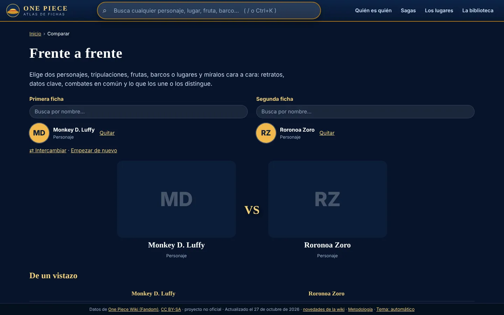

### Temas pergamino y noche, y móvil

El tema sigue el del sistema y se puede cambiar a **pergamino** (claro) o **noche** (oscuro) desde el pie de página. Toda la web se adapta al móvil: el grafo y la ficha se apilan y el menú pasa a hamburguesa.

| Pergamino | Noche |
|---|---|
| 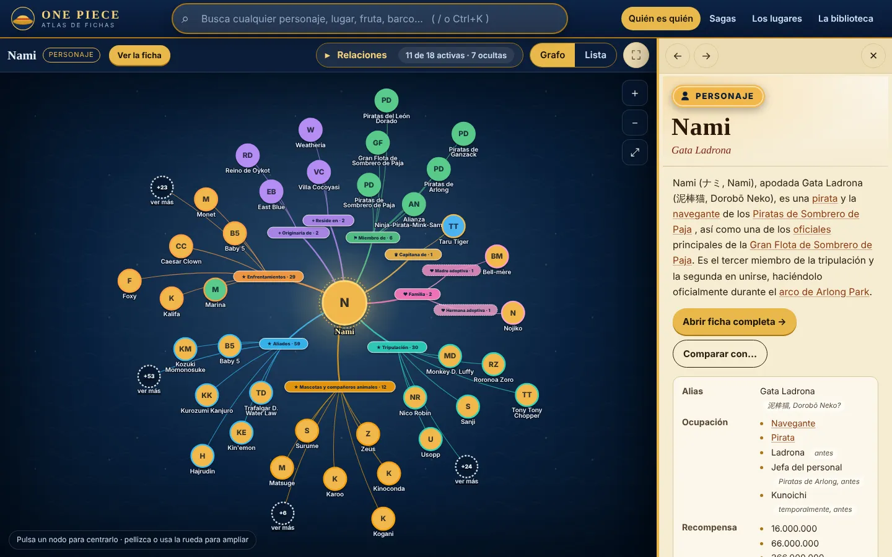 | 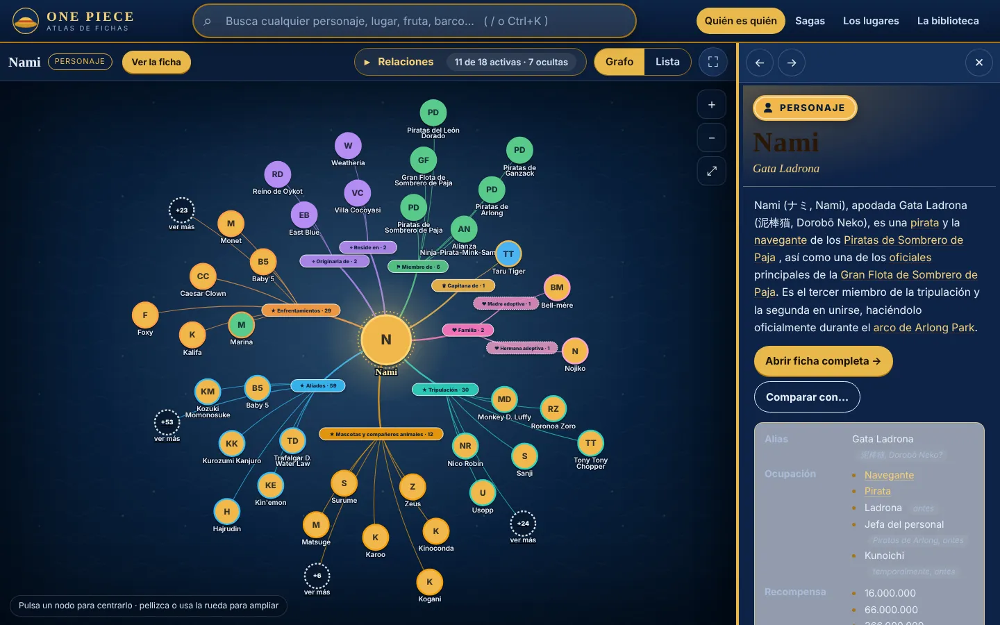 |

| Grafo en móvil | Ficha en móvil | Mapa en móvil |
|---|---|---|
| 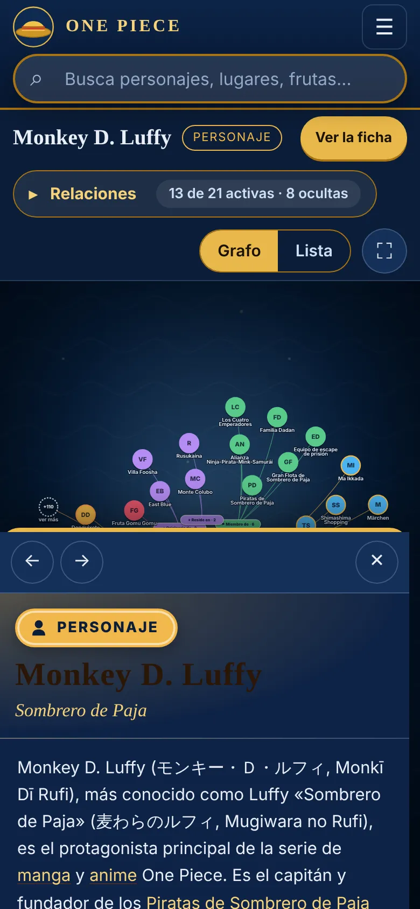 | 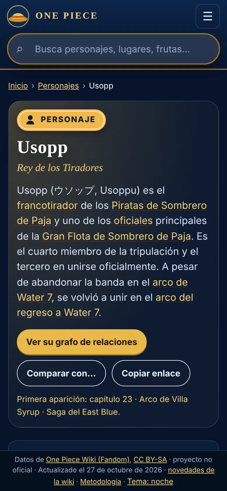 | 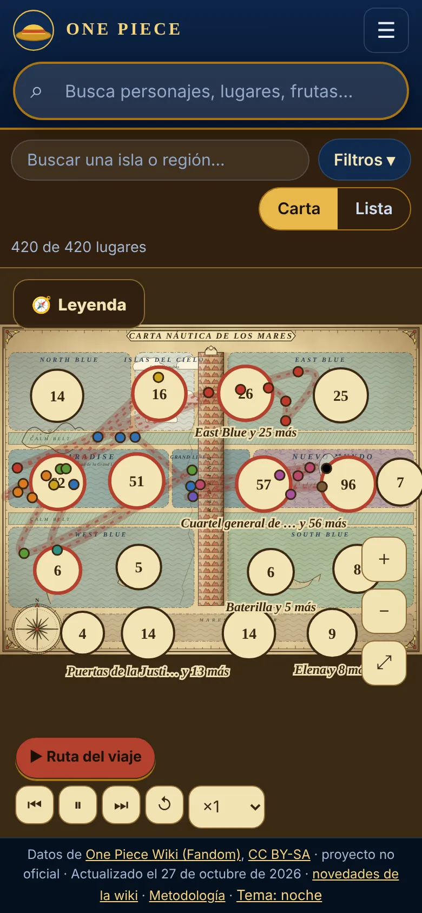 |

### Resumen de secciones

| Sección | Qué hace |
|---|---|
| Portada | Qué es, buscador grande, ejemplos, accesos y atajos («¿Qué quieres consultar?») |
| Quién es quién | Grafo de relaciones por ficha, con categorías y subcategorías, vista lista y ficha lateral |
| Sagas | Ruta del viaje saga a saga y arco a arco, con portadas y desplegables |
| Los lugares | Carta náutica con ruta animada, filtros, leyenda y modo lista |
| La biblioteca | Todas las fichas con filtros, índice A–Z y ranking de recompensas |
| Ficha completa | El artículo íntegro de la wiki con atribución |
| Comparar | Dos fichas lado a lado |
| Novedades | Lo que ha cambiado en la wiki desde la última actualización |
| Metodología | Cómo se obtuvieron los datos, tipado, límites y atribución |

Las URL son compartibles (`#/ficha/Roronoa%20Zoro`, `#/biblioteca?t=lugar&m=4`, `#/comparar?a=…&b=…`) y también funcionan abriendo `dist/index.html` con doble clic.

## Cómo se construye el atlas

1. **Rastreo** (`npm run crawl`, `scripts/crawl.mjs`, `scripts/supervisor.mjs`): descarga cada artículo por la API MediaWiki de la wiki, a ≤1 petición/s, con User-Agent neutro, reanudable y con reintentos. La lista de páginas sale del índice de sitemaps de la wiki (`data/urls_ns0.txt`).
2. **Jerarquía de categorías** (`npm run catparents`): árbol de categorías de la wiki, que alimenta el tipado.
3. **Tipado**: cada ficha recibe un tipo (personaje, organización, fruta del Diablo, barco, lugar, saga, arco, capítulo, episodio…) por **votos ponderados** de varias señales: categorías y sus padres, plantillas, campos de la infobox, primera frase y enlaces entrantes, con una segunda pasada contextual. Las correcciones manuales viven en `data/tipos-manual.json` y las confirmaciones en `data/tipos-revisados.txt`.
4. **Relaciones**: se extraen solo con evidencia estructural de la propia wiki, siempre en los dos sentidos: el campo *Familia* de la infobox («Nombre (Rol)»), las secciones del artículo (Familia, Tripulación, Aliados, Enemigos…), los subtítulos de la sección *Relaciones* (el tipo de vínculo sale de su primer párrafo), los títulos «A y B vs. C» de combates y arcos, el arco → saga, y evoluciones o sucesiones con patrones muy estrictos (p. ej. Gear 2 → 3 → 4 → 5, o Going Merry → Thousand Sunny). Nada se infiere por similitud.
5. **Artículos y lotes** (`npm run build:data`, `scripts/build-data.mjs`): los artículos se limpian con lista blanca de etiquetas (sin scripts ni estilos); los personajes largos, que la wiki reparte en subpáginas (Historia, Personalidad…), se unen en una sola ficha. Se generan el índice, el grafo, las posiciones del mapa y lotes de artículos y detalles que la web baja bajo demanda.
6. **Informe de calidad** (`data/informe-calidad.json`): fichas sin clasificar, confianza baja, tipos asignados por defecto y recuento por tipo. Debe mantenerse en 0 sin clasificar.
7. **Auditorías** (sin red, sobre los datos ya generados): `scripts/auditoria-final.mjs` (consistencia de lo publicado), `scripts/auditoria-enlaces.mjs` (enlaces internos y externos de los artículos), `scripts/auditoria-familia.mjs` (parentescos de los personajes principales) y `scripts/cobertura.mjs` (compara las cifras de la wiki con lo descargado).
8. **Compilación** (`npm run build`): TypeScript + Vite → `dist/`.

## Arquitectura

- **Web estática, sin servidor ni base de datos**: TypeScript + [Vite](https://vite.dev/) y [d3](https://d3js.org/) (force, zoom, drag, selection) para el grafo. Sin framework: cada sección es una clase `View` con `mount`/`unmount`.
- `src/main.ts` (enrutado por hash, tema, pie), `src/nav.ts` (URL compartibles), `src/data.ts` (carga de datos y lotes bajo demanda), `src/panel.ts` (ficha lateral), `src/search.ts` (buscador), `src/gallery.ts`.
- `src/views/`: `home`, `quien` (grafo), `sagas`, `carta` (mapa), `library`, `ficha`, `compare`, `news`, `method`.
- `scripts/`: rastreo, construcción de datos, actualización, pruebas, auditorías, capturas y publicación.
- `data/`: estado pequeño versionado (`sync.json`, `revs.json`, `redirects.json`, `novedades.json`, informes). Las fichas descargadas (`data/pages/`) **no** se versionan: viven en la caché privada de Actions o en el PC.
- La web carga lo mínimo para pintar el grafo y baja cada artículo bajo demanda; funciona abriendo `dist/index.html` sin servidor (Hash routing + datos en ficheros `.js`).

## Ejecutarlo y probarlo en local

Necesitas [Node.js](https://nodejs.org/) 22 o superior.

```bash
npm ci                    # dependencias
npm run crawl             # rastreo completo por la API (tarda horas la primera vez; reanudable)
npm run catparents        # jerarquía de categorías
npm run build:data        # tipado, relaciones, artículos y lotes -> public/data
npm run build             # compila la web -> dist/
npm start                 # sirve dist/ en http://localhost:4173
npm run dev               # servidor de desarrollo con recarga
npm run all               # build:data + build + start
```

En Windows basta con el doble clic en `One Piece Wiki.lnk` o `Abrir One Piece Wiki.bat` (compila solo si falta `dist/`).

**Pruebas de humo** (Chrome o Edge reales, variable `BROWSER` con la ruta del ejecutable): `node scripts/prueba-humo.mjs` abre `dist/` y comprueba buscador, grafo (formas, capas, pestañas), fichas completas, todas las sagas y sus desplegables, mapa y ruta, biblioteca, comparador, móvil y accesibilidad básica. `node scripts/captura.mjs tiempos` mide tiempos de carga y `node scripts/medir-dist.mjs` los tamaños.

**README al día**: `node scripts/readme.mjs --comprobar` (también corre como check en cada PR) falla si algún README no menciona una sección de la web o lleva cifras escritas a mano.

## Publicación y actualización automática

El repositorio usa **dos ramas**:

- `fuente`: el código (`src/`, `scripts/`), los datos pequeños de estado y el workflow. Es donde se trabaja.
- `main`: solo el sitio ya compilado (`dist/`). Es lo que sirve GitHub Pages en <https://carlosdarko.github.io/one-piece-wiki/>. **No se edita a mano**: cada publicación la reescribe entera.

El workflow `.github/workflows/actualizar.yml` (copia en `actions/actualizar.yml`) se ejecuta **cada lunes a las 07:00 UTC** y también a mano (Actions → «Actualizar el atlas» → Run workflow). Detecta cambios en la wiki por la API, descarga solo las fichas nuevas o modificadas, reconstruye, pasa las pruebas de humo con Chrome, regenera las capturas y las cifras del README y **publica en `main` solo si las pruebas pasan**. La caché de fichas vive en la caché privada de Actions; si caduca, el rastreo completo tarda ≈2 h. Para desactivarlo: Actions → «Actualizar el atlas» → «···» → Disable workflow. `actions/LEEME.md` explica cómo se montó.

`publicar.bat` / `node scripts/publicar.mjs` siguen sirviendo para publicar manualmente desde el PC (necesitan Git y `gh auth login`).

> **Los README se mantienen solos.** Las cifras del README de `main` (fichas, relaciones, fecha) las regenera `scripts/readme.mjs` en cada actualización a partir de `data/`, y el check «README al día» falla si un README no menciona alguna sección de la web o lleva cifras fijas. Si añades una sección o función, descríbela en ambos README en la misma PR.
>
> El README que se ve en `main` es `actions/README-sitio.md`: el workflow lo copia en cada publicación. Para cambiarlo, edita ese fichero en `fuente`.

## Capturas

Las imágenes de `docs/capturas/` (escritorio 1440×900 y móvil 390×844) las genera `node scripts/capturas-readme.mjs [carpeta-del-sitio]` con un navegador real sobre el sitio compilado: sirve `dist/` en local, recorre las vistas y guarda WebP optimizado. El workflow semanal las regenera y las sube a `fuente`; para refrescarlas a mano: `npm run build` y luego `BROWSER=/ruta/a/chrome node scripts/capturas-readme.mjs`. Si añades una sección nueva, añade su captura en ese script y su descripción en este README.

## Calidad del tipado

Objetivo: 0 fichas sin clasificar, 0 con confianza < 0,5 y 0 asignadas por defecto; las cifras vigentes están en `data/informe-calidad.json`. Las evoluciones (`evoluciona_en`) solo se crean con evidencia estructural.

## Limitaciones conocidas

- Tipos y relaciones son automáticos: puede haber errores en fichas con poca información.
- Las imágenes se cargan desde el CDN de Fandom (hotlink); sin internet, o si Fandom las bloquea, se ven iniciales de colores en lugar de fotos.
- El mapa de lugares es esquemático; hay lugares que la wiki no sitúa en ningún mar.
- La web depende de la estructura de la wiki: si Fandom cambia sus plantillas, el tipado puede necesitar ajustes (el informe de calidad y la cobertura lo avisan).

## Créditos y licencia

El texto procede de la [One Piece Wiki en español (Fandom)](https://onepiece.fandom.com/es/), © sus colaboradores, bajo licencia [CC BY-SA 3.0](https://creativecommons.org/licenses/by-sa/3.0/); el contenido derivado se comparte bajo la misma licencia. Cada ficha enlaza con su página original y su historial de autores. Las imágenes pertenecen a sus titulares. One Piece es obra de Eiichiro Oda (Shueisha) y su anime de Toei Animation.

Proyecto de aficionados, no oficial: sin relación con Eiichiro Oda, Shueisha, Toei Animation ni Fandom.
